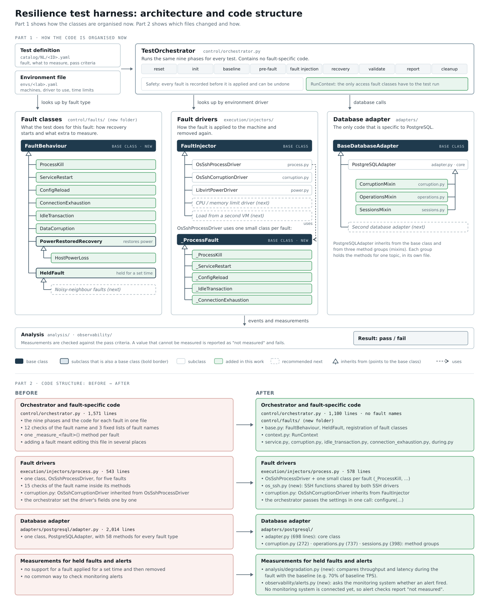

# Code improvement: plug-in fault architecture

## Overview

The harness injects faults into a database (process kill, data-page corruption, connection
flood, and others) and measures the effect: transactions lost, recovery time, corruption.

The **orchestrator** runs every test through the same nine phases (reset, init, baseline,
pre-fault, fault injection, recovery, validate, report, cleanup). Before this work, the code
specific to each fault was written inside the orchestrator, so adding a fault meant
modifying the code that runs every test.

After this work, each fault is implemented in its own class and registered by name. The
orchestrator calls the same methods for every fault and contains no fault-specific code.
Adding a fault no longer requires changing the orchestrator. The behaviour of existing tests
is unchanged.



*Figure, part 1: how the code is organised now. The orchestrator uses three groups of
classes: fault classes, fault drivers and the database adapter. In each group the base class is
dark, and every subclass is joined to its base class by an arrow that points to the base
class. Part 2: each file that changed, before and after. Green = added in this work.
Dashed = recommended next.*

---

## Summary

| | Before | After |
|---|---|---|
| Adding a new fault | Modify the orchestrator in several places | Add a new class; the orchestrator is not modified |
| Fault names in the orchestrator code | 12 checks + 3 fixed lists | none |
| Orchestrator size | 1,571 lines | 1,100 lines |
| Database adapter | one class with 58 methods | one core class + three groups by topic |
| Support for faults applied for a set time and then removed | none | added |
| Behaviour of existing tests | — | unchanged |

---

## 1. Design before this work

### What was already in place

| Practice | How it was applied |
|---|---|
| Abstract base classes | Every fault driver implements the same methods: check it can run (`preflight`), apply the fault (`inject`), undo it (`revert`). |
| Database code in one place | Only the database adapter contains PostgreSQL-specific code, so another database type can be added later. |
| Configuration separate from code | The test definition states which fault to apply and what to measure. A separate environment file states the machines and tools. The same test runs in any environment. |
| Safety | Every fault is recorded before it is applied and can be undone, including after a harness crash. A value that cannot be measured is reported as "not measured" and fails the test. It is never treated as a pass. |

### Problems found

| # | Problem | Example |
|---|---|---|
| 1 | **Adding a fault required changing the orchestrator.** It checked fault names in 12 places and kept 3 fixed lists of fault names. | Adding CPU throttling meant changing the orchestrator in several places. An error there could break the process-kill test. |
| 2 | **Classes with too many responsibilities.** The orchestrator was 1,571 lines. The database adapter was one class with 58 methods covering every fault type. | Two developers working on different faults both had to change the same large file. |
| 3 | **Incorrect inheritance.** The data-corruption driver inherited from the process-kill driver only to reuse a few helper functions. | A change to the process-kill driver could change the data-corruption driver without anyone noticing. |
| 4 | **One driver class handling five faults with `if` statements.** The process driver checked which fault it was running in 15 places. | Adding a sixth process fault meant changing methods used by the other five. |
| 5 | **The orchestrator set the driver's internal fields directly.** | Renaming a field in a driver required changing the orchestrator. |
| 6 | **Duplicate registrations were not detected.** If two classes registered the same fault name, the last one replaced the first without an error. | A copied file that kept the original fault name could replace the real fault class. |
| 7 | **Fault classes accessed the orchestrator's internal data directly.** | Renaming an internal field of the orchestrator could break every fault class. |
| 8 | **No support for faults applied for a set time and then removed.** The noisy-neighbour tests apply load or resource limits for several minutes, measure the slowdown, then remove them. | Each noisy-neighbour test would have needed its own changes to the orchestrator. |

---

## 2. What was improved

### Problems 1–5: one class per fault

**Before**: the orchestrator contained the code for each fault:

```python
# orchestrator.py
if self.scenario.fault.type == "idle_in_transaction":
    m.update(await self._measure_idle_transaction(events))
if self.scenario.fault.type == "data_corruption":
    m.update(await self._measure_corruption(...))
# a new fault needed another "if" here
```

**After**: each fault is a class in its own file. The orchestrator calls the same method for
every fault:

```python
# control/faults/service.py
@register_fault
class ProcessKill(FaultBehaviour):
    fault_type = "process_kill"
    expects_outage = True          # this fault must stop writes

# orchestrator.py: one line, used for every fault
m.update(await self.fault_behaviour.measure(events))
```

**How the orchestrator finds the class:** the test definition contains
`fault.type: process_kill`. `@register_fault` adds the class to a table keyed by that name.
When a test starts, the orchestrator looks the name up and creates a `ProcessKill` object.
Each fault class implements the same methods (`measure()`, `expects_outage`, ...) with its
own behaviour.

The same approach was applied to the rest of the code:

| Area | Before | After |
|---|---|---|
| Orchestrator | fault names in 12 checks + 3 lists | none; an automated test fails if one is added again |
| Database adapter | one class, 58 methods | core class + three method groups (corruption, background operations, sessions), combined into the same adapter |
| Process driver | one class, 15 `if` checks on the fault name | one small class per fault |
| Data-corruption driver | inherited from the process-kill driver | inherits only from the common driver base class; shared helper functions are in a separate module |
| Driver settings | set field by field by the orchestrator | one method call: `configure(...)` |

### Problems 6–7: registration checks and a defined interface for fault classes

- **Duplicate names are rejected.** Registering a second class under an existing fault name
  stops the harness with an error that names both classes, for example:
  `fault_type 'data_corruption' is registered twice: DataCorruption and NewDataCorruption`
- **Fault classes access the test run only through `RunContext`.** It exposes only what a
  fault class needs: the test definition, the database adapter, the results being collected,
  the fault times, and named actions such as "undo the fault". The orchestrator's internal
  fields are no longer visible to fault classes. An automated test fails if a fault class
  accesses them directly.

### Problem 8: faults applied for a set time and then removed

Example test NL-N-07: *while a large analytic query runs, normal transactions must keep at
least 70% of their usual throughput, and their 99th-percentile latency must stay within
2 × the usual value.*

| Requirement | Implementation |
|---|---|
| Apply, hold, remove | A fault class based on `HeldFault` applies the fault, keeps it in place for the duration set in the test definition, then removes it. Recovery time is measured from the removal. |
| Long holds | Each phase has a time limit set per environment, for example 120 seconds. The limit is now increased by the hold duration, so a 300-second hold does not exceed it. |
| Readings at fixed points | Methods called at the start and end of the baseline and of the hold (for example `on_hold_start`, `on_hold_end`), to record counters such as cache hits. |
| Additional measurements | A fault class can add its own background measurements, for example CPU steal time or CPU-throttle counters. They start and stop with the standard ones. |
| Throughput and latency during the hold | One shared calculation. Example: baseline 200 transactions/s and 10 ms; during the hold 140 transactions/s and 30 ms → throughput ratio **0.70** (passes "≥ 0.70"), latency ratio **3.0** (fails "≤ 2"). |
| Monitoring alerts | One interface for checking whether the monitoring system raised an alert. No monitoring system is connected in the lab yet, so these checks report "not measured", with the reason. |

If a held fault has no duration in its test definition, the test is stopped **before** the
fault is applied, so the fault cannot be left in place indefinitely.

### Follow-up changes (after the review)

| Change | Before | After |
|---|---|---|
| Report text for each fault | `analysis/report.py` contained the summary lines for the idle-transaction, checkpoint and corruption tests. | Each fault class supplies its own summary lines (`summary_lines`). The report contains no fault names. |
| Settings and objects a fault needs | One adapter method chose what to read or create by checking the fault name. | One adapter method per purpose, for example `observe_idle_transaction_settings()` or `prepare_checkpoint_objects()`. The fault class calls the one it needs. |
| Duplicate driver registration | A second driver for the same fault replaced the first without an error. | Rejected with an error that names both drivers. |
| Name of the environment section | `fault.driver` in the test definition held the name of the environment section, not a driver. | Renamed to `fault.section`. The old name is still accepted. |
| Tests with two faults | A second fault (`compound.fault_b`) was silently never applied. | The test is refused before anything is applied, with the reason. The design for multi-machine and two-fault tests is in README §13. |
| Unreadable idle-session state (NL-M-05) | A failed read was treated as "session not ended", which is a guess. | Reported as "not measured", with the reason. |
| Load rate | A test definition without `rate_tps` ran as fast as the machine allowed. | The catalog checks refuse it (Framework §7.5). The workload profiles are described in README §7. |

### Steps to add a new fault

| Step | What to add |
|---|---|
| 1 | Test definition `catalog/NL/<ID>.yaml`: the fault, what to measure, and the pass criteria |
| 2 | Driver class: how to apply and remove the fault on the machine |
| 3 | Fault class, if the test needs extra steps or measurements (based on `HeldFault` for faults applied for a set time) |
| 4 | Automated tests using a simulated database |

The orchestrator, the safety components and the reporting are not modified.

### Verification

- **Comparison with previous results:** the results of 122 existing test runs were saved
  before the work and compared after each change. There were **0 differences** in
  measurements and pass/fail results. The one intended difference after the follow-up
  changes: NL-M-05 now reports `dead_tuples_not_removable` as "not measured" instead of
  leaving it out when the idle session has already ended.
- **Automated tests:** 427 → 452 passing (the 2 Elle tests need Java 21 on the machine). Each new test was first run without its fix, to
  confirm that it fails.
- **Lab runs:** all 12 tests that the lab can run passed on the real machines with the
  latest code (23 Oct, new harness VM). For every test, every pass criterion was evaluated on
  a measured value, no committed transaction was lost, and the integrity check was clean.
  NL-C-04 is skipped, because the lab has no separate disk for the write-ahead log.

---

## 3. Further improvements

### Required first

| Item | Reason |
|---|---|
| Rebuild NL-N-07 using the new structure | It was written for the previous code. It will be the first test to use the new support for held faults. |

### Decisions needed

| Question | Reason |
|---|---|
| How should checks that apply only to a cluster, such as "the leader must not change", be handled on a single server? | They currently fail on a single server. Proposal: mark them as cluster-only, skip them on a single server, and state this in the report. |
| Which monitoring system should the harness query for alerts? | Until one is connected, every alert check reports "not measured". |
| How long should each noisy-neighbour test hold the fault? | The specification defines only one duration (4 hours, NL-N-08). |

### Further design changes (when the tests that need them are developed)

| Item | Details |
|---|---|
| Tests using more than one machine | Noisy-neighbour tests need a second VM to generate load; cluster tests need a standby server. A test can currently target only one machine. Design: README §13. |
| Two faults in one test | Some cluster tests apply two faults together. The test definition supports this; the orchestrator refuses such a test until it is built. Design: README §13. |
| Smaller database interface | The database adapter's base class has 49 methods, which a second database type would have to implement. Splitting them into groups would make that easier. |
| Simplify the orchestrator's validate phase | About 80 lines of result calculations can move to the analysis module. |
| One unreliable test | One existing test fails about once in six runs on a heavily loaded machine. |
